# Beaurette | 뷰렛

<h2 align="center">🛠️ Tech Stack</h2>

<table align="center">
  <thead>
    <tr><th align="center">Category</th><th align="center">Technologies</th></tr>
  </thead>
  <tbody>
    <tr><td align="center"><strong>Languages</strong></td><td align="center">  </td></tr>
    <tr><td align="center"><strong>Backend &amp; UI</strong></td><td align="center">  </td></tr>
    <tr><td align="center"><strong>AI &amp; Agents</strong></td><td align="center">  </td></tr>
    <tr><td align="center"><strong>Database &amp; Search</strong></td><td align="center">  </td></tr>
    <tr><td align="center"><strong>Server &amp; Cloud</strong></td><td align="center">  </td></tr>
    <tr><td align="center"><strong>Tools &amp; Testing</strong></td><td align="center">   </td></tr>
  </tbody>
</table>

## 팀원 소개

<table align="center">
  <tbody>
    <tr>
      <td align="center" valign="middle" width="160">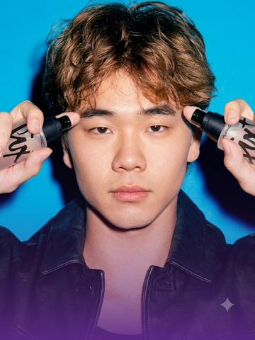</td>
      <td align="center" valign="middle" width="160"></td>
      <td align="center" valign="middle" width="160"></td>
      <td align="center" valign="middle" width="160"></td>
      <td align="center" valign="middle" width="160"><!-- 이세희 소개 이미지 추가 예정 --></td>
    </tr>
    <tr>
      <td align="center"><strong>김경민</strong></td>
      <td align="center"><strong>권준호</strong></td>
      <td align="center"><strong>유지호</strong></td>
      <td align="center"><strong>이형민</strong></td>
      <td align="center"><strong>이세희</strong></td>
    </tr>
  </tbody>
</table>

### 팀원별 역할 및 기여

| 팀원 | 작업 브랜치 | 주요 역할 | 구현 및 기여 | 대표 커밋 |
| --- | --- | --- | --- | --- |
| **김경민** | [`kgm`](https://github.com/SKNETWORKS-FAMILY-AICAMP/SKN35-3rd-5Team/tree/kgm) | 시스템 기반 설계 · API · 통합 챗봇 | 프로젝트 구조·LangGraph 워크플로 골격 설계, FastAPI 검토 API·입력 검증, 자연어 요청의 검토/생성/질문 분기와 대화 맥락 처리, 챗봇 팝업·사이드바 개선, Docker 구성 및 PR 통합 | [API·검증](https://github.com/SKNETWORKS-FAMILY-AICAMP/SKN35-3rd-5Team/commit/e5cf529) · [챗봇 Q&A](https://github.com/SKNETWORKS-FAMILY-AICAMP/SKN35-3rd-5Team/commit/52948a8) |
| **권준호** | [`kjh`](https://github.com/SKNETWORKS-FAMILY-AICAMP/SKN35-3rd-5Team/tree/kjh) | 판정 엔진 · 평가 · 시장 비교 | 규칙·GPT 판정 및 베이스라인 평가, 효능별 실증 수치 대조, 시장 문구·공개 실증·성분 근거 연결, 창작 광고 세트, 후보 비교 및 예상 매출 시나리오 연결 | [판정·평가](https://github.com/SKNETWORKS-FAMILY-AICAMP/SKN35-3rd-5Team/commit/a8e57f8) · [수치 검증](https://github.com/SKNETWORKS-FAMILY-AICAMP/SKN35-3rd-5Team/commit/74385e0) · [후보 비교](https://github.com/SKNETWORKS-FAMILY-AICAMP/SKN35-3rd-5Team/commit/84794e1) |
| **유지호** | [`yjh`](https://github.com/SKNETWORKS-FAMILY-AICAMP/SKN35-3rd-5Team/tree/yjh) | RAG · 인덱싱 · 광고문 생성 | 조항 단위 청킹, Qdrant Cloud 적재·BM25 색인, 하이브리드 검색과 메타데이터·경량 reranker 개선, 검색 평가, 검토 기준에 따른 광고문 생성 워크플로 구현 | [벡터 DB 적재](https://github.com/SKNETWORKS-FAMILY-AICAMP/SKN35-3rd-5Team/commit/07d61a4) · [생성 워크플로](https://github.com/SKNETWORKS-FAMILY-AICAMP/SKN35-3rd-5Team/commit/379286c) · [검색 개선](https://github.com/SKNETWORKS-FAMILY-AICAMP/SKN35-3rd-5Team/commit/7a97bf8) |
| **이세희** | [`lsh`](https://github.com/SKNETWORKS-FAMILY-AICAMP/SKN35-3rd-5Team/tree/lsh) | Streamlit UI · UX · 시각 디자인 | 검토 대화·상세페이지·규정 열람 화면, 근거 패널과 위험 표현 연동, 후보 선택·진행 상태 UI, 홈 화면 및 브랜드 디자인, 공통 스타일·접근성 개선 | [검토 화면](https://github.com/SKNETWORKS-FAMILY-AICAMP/SKN35-3rd-5Team/commit/bb20da5) · [검토 UX](https://github.com/SKNETWORKS-FAMILY-AICAMP/SKN35-3rd-5Team/commit/d988ed9) · [홈 디자인](https://github.com/SKNETWORKS-FAMILY-AICAMP/SKN35-3rd-5Team/commit/f61e935) |
| **이형민** | [`lhm`](https://github.com/SKNETWORKS-FAMILY-AICAMP/SKN35-3rd-5Team/tree/lhm) | 데이터 · 교정/역검증 · 배포 | 법령·지침·사례·성분 데이터 및 골든셋 구축, 실증 범위에 따른 교정 후보 제안·역검증, 제품 직접 등록·성분 검색, 생성 재료·후보 선별 개선, Render 배포 및 통합 안정화 | [원본 데이터](https://github.com/SKNETWORKS-FAMILY-AICAMP/SKN35-3rd-5Team/commit/489313a) · [제안·검증](https://github.com/SKNETWORKS-FAMILY-AICAMP/SKN35-3rd-5Team/commit/d9f882e) · [배포 구성](https://github.com/SKNETWORKS-FAMILY-AICAMP/SKN35-3rd-5Team/commit/66980ac) |

역할은 로컬에 저장된 담당자별 원격 브랜치 참조(`origin/*`)의 작성자별 구현 커밋과 변경 파일을 기준으로 정리했습니다. 공동 수정·통합된 기능은 주 기여 영역으로 표시했으며, 병합으로 들어온 다른 작성자의 커밋을 개인 단독 기여로 계산하지 않았습니다.

---

**화장품 광고 문구를 규정 근거로 검토하고, 제품이 보유한 실증 범위 안에서 대안을 제안하는 RAG 에이전트**

SK Networks Family AI Camp 35기 · 3차 프로젝트 · 5팀

[서비스 화면](https://beaurette-app.onrender.com) · [API 문서](https://beaurette-api.onrender.com/docs) · [API 가이드](api/README.md) · [UI 가이드](app/README.md)

배포 환경의 기동 상태에 따라 첫 응답이 지연될 수 있습니다.

### 서비스 화면

2026-10-15 배포 서비스에서 직접 캡처한 화면입니다. 최신 홈 디자인과 내 제품 등록, 통합 챗봇, 광고문 생성, 시장 비교·매출 시나리오를 반영했습니다. 이미지를 누르면 원본 크기로 볼 수 있습니다.


| 문구 검토 · 규정 근거 | 수정 후보 · 역검증 |
| :---: | :---: |
| [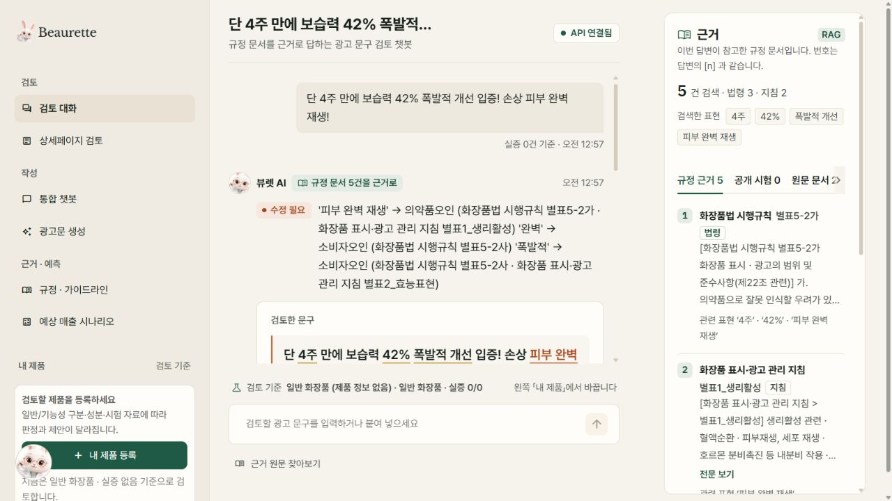](docs/screenshots/review-2026-10-15.jpg) | [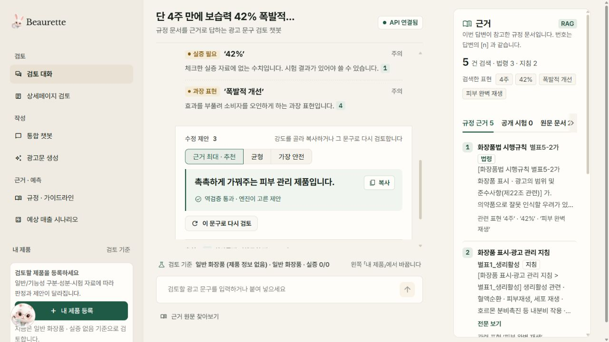](docs/screenshots/review-candidates-2026-10-15.jpg) |
| 문제 표현과 연결된 규정 원문 확인 | 근거 최대·균형·가장 안전 후보 선택 |

| 통합 챗봇 | 광고문 생성 |
| :---: | :---: |
| [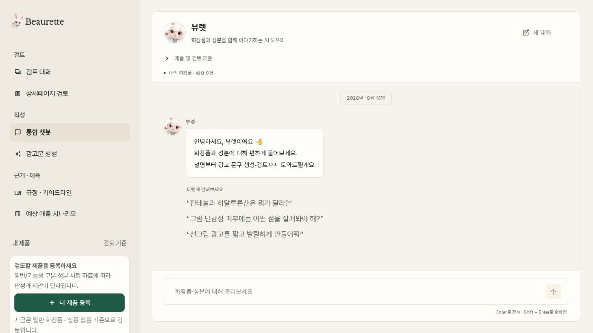](docs/screenshots/chat-2026-10-15.jpg) | [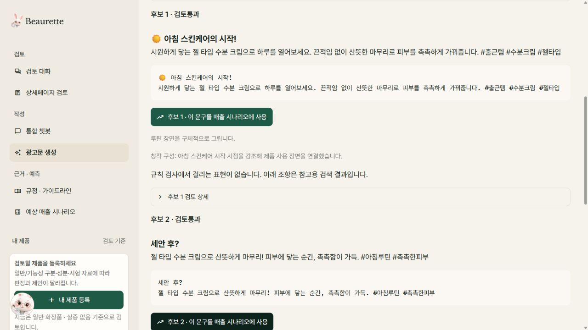](docs/screenshots/generate-2026-10-15.jpg) |
| 화장품·성분 Q&A부터 생성·검토까지 | 검토를 통과한 후보 확인 및 매출 시나리오 연결 |

| 내 제품 · 시장 비교 | 예상 매출 시나리오 |
| :---: | :---: |
| [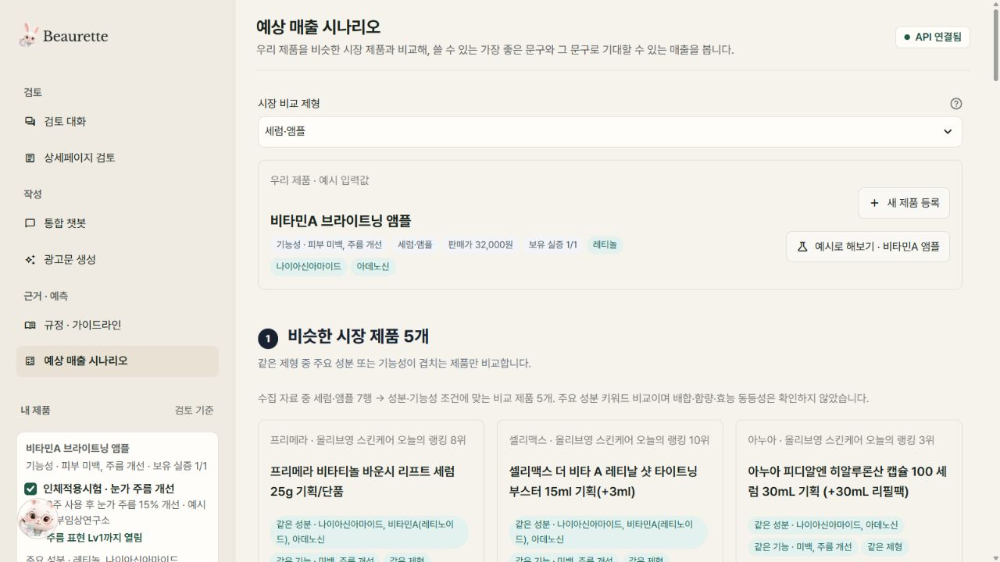](docs/screenshots/market-2026-10-15.jpg) | [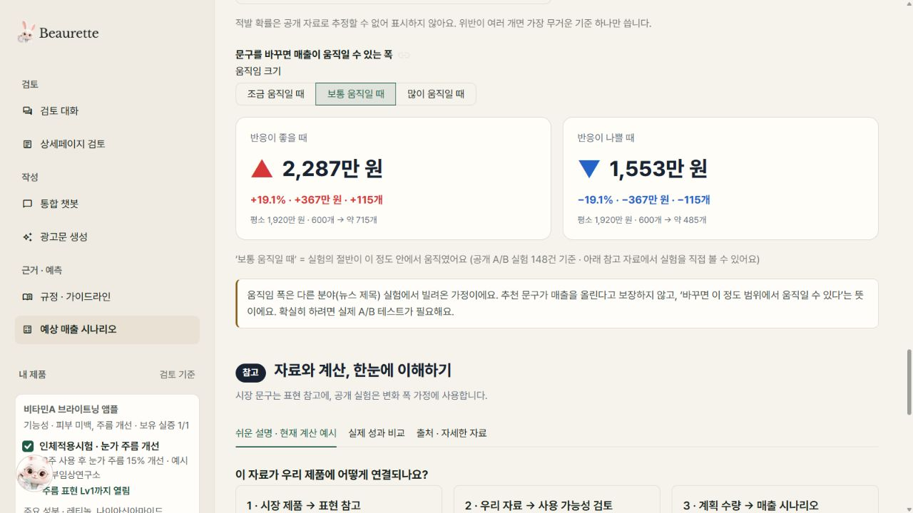](docs/screenshots/forecast-2026-10-15.jpg) |
| 예시 제품의 성분·기능성·제형을 기준으로 비교 | 입력 가정에 따른 변화 범위 확인 |

검토·광고문 생성 이미지는 실제 API 실행 결과입니다. 시장 비교·매출 화면은 앱에서 제공하는 비타민A 앰플 예시를 사용했으며, 표시된 판매량과 매출 변화는 가정 기반 시나리오입니다.

## 1. 프로젝트 소개

화장품 광고는 같은 표현이라도 일반/기능성 제품 여부와 보유 시험 자료에 따라 검토 결과가 달라집니다. 규정 문서를 찾는 일과 실제로 사용할 수 있는 대체 문구를 만드는 일이 분리되어 있어, 마케터가 작성과 검토를 반복해야 합니다.

뷰렛은 **문구 검토 → 근거 확인 → 수정 제안 → 제안 문구 재검증**을 하나의 흐름으로 연결합니다. 제품 정보와 실증 자료를 함께 입력받아 표현의 상한을 정하고, 광고문 신규 생성과 시장 참고 사례 비교까지 지원합니다.

| 해결하려는 문제 | 구현 방식 |
| --- | --- |
| 판정 이유와 출처를 확인하기 어려움 | 법령·고시·지침·사례를 검색하고 조항 번호와 원문 스니펫 제공 |
| 같은 문구를 제품 맥락 없이 일괄 판정 | 제품 분류·기능성 유형·보유 실증 자료를 판정과 생성에 반영 |
| LLM이 수정하면서 위험 표현이나 숫자를 다시 생성 | 생성 결과를 규칙 엔진·실증 수치 검증기로 재검사 |
| 안전한 표현만 남기면서 광고의 구체성이 사라짐 | 제형·사용감·성분 역할·확인된 제품 사실을 생성 재료로 활용 |

이 서비스는 광고 사전 검토를 돕는 프로토타입입니다. 결과는 수집된 규정과 구현된 규칙에 기반한 검토 의견이며, 최종 법률 판단이나 광고 적합성 인증을 대신하지 않습니다.

## 2. 주요 기능

| 기능 | 제공 내용 |
| --- | --- |
| **단일 문구 검토** | 가능·조건부·불가 판정, 문제 표현, 근거 조항, 추가로 필요한 시험 안내 |
| **교정 후보 제안** | 근거 최대·균형·가장 안전의 후보, 변경점·검증 결과·A/B 실험 가설 제공 |
| **광고문 생성** | 작성 요청·채널·어조·제품 정보를 반영하고, 규정 검색·후보 검증·필요 시 재작성 |
| **통합 챗봇** | 대화 맥락에 따라 검토·생성·화장품/성분 Q&A 분기, 이전 후보를 참조한 수정 요청 처리 |
| **상세페이지 검토** | 긴 광고문을 문장별로 나누어 판정하고 교정본 확인·복사·내려받기 |
| **제품 직접 등록** | 제품 분류·기능성·성분·제형·제품 사실·보유 실증 입력 및 검토 기준 변경 |
| **규정·가이드라인 열람** | 관련 조항 검색, 관리지침과 적발 사례 확인 |
| **시장 비교·매출 시나리오** | 유사 제품·문구 참고, 생성 후보 비교, 사용자 가정에 따른 매출·판매량 범위 계산 |

시장 광고는 표현 참고 자료로 사용하며, 자사 제품의 효능 실증으로 전용하지 않습니다. 예상 매출은 학습된 예측 모델의 출력이 아니라 입력값과 가정에 따른 시나리오입니다.

### 사용 흐름

1. **내 제품 등록**: 일반/기능성 여부와 성분·제품 사실·보유 실증을 입력합니다.
2. **검토 또는 생성**: 기존 광고 문구를 넣거나 채널·어조와 함께 작성 요청을 입력합니다.
3. **판정 근거 확인**: 문제 표현과 연결된 조항 및 원문을 확인합니다.
4. **후보 선택**: 검증을 통과한 후보의 표현 강도와 변경점을 비교합니다.
5. **후속 검토**: 실증 자료를 변경하여 다시 검토하거나, 선택한 후보를 매출 시나리오로 연결합니다.

예를 들어 동일한 수치 광고라도 해당 효능·기간·수치를 뒷받침하는 보유 시험이 있는지에 따라 결과와 교정 방향이 달라집니다. 성분의 일반적인 역할 설명은 특정 완제품의 효능 시험으로 취급하지 않습니다.

## 3. 시스템 아키텍처


세 워크플로가 사용하는 검색·모델·검증 기능은 공통 영역으로 묶었습니다. 각 연결선의 신호가 화살표 방향으로 이동하며, 경로별 시작 시점을 달리해 전달 방향을 보여줍니다.

<details>
<summary>상세 연결 관계 보기 (Mermaid)</summary>

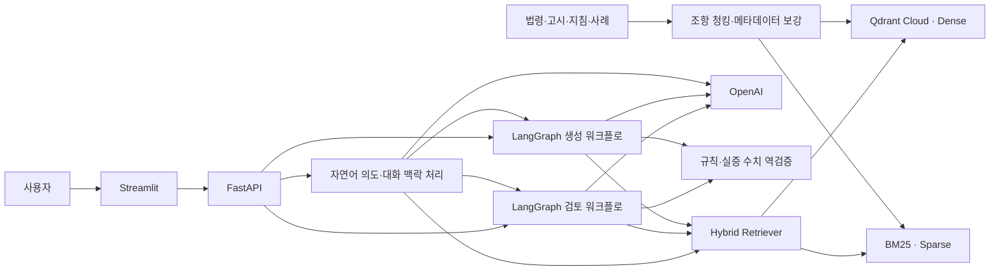

</details>

### 검토 워크플로


<details>
<summary>상세 분기 보기 (Mermaid)</summary>

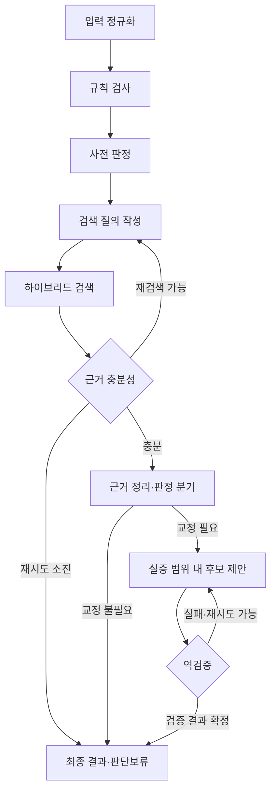

</details>

검토 그래프는 9개 노드로 구성하고 재검색·재제안 횟수를 제한합니다. 생성 그래프는 별도로 구성하되 같은 규칙 엔진과 검증기를 재사용합니다. 조건부·불가 판정에는 근거 조항을, 조건부 판정에는 필요한 추가 시험을 포함하도록 Pydantic 응답 계약을 검증합니다.

## 4. 핵심 구현과 기술적 의사결정

### 하이브리드 검색과 출처 보존

- 원문을 조항 단위로 나누고 출처·조항·법적 효력·제품 범위를 메타데이터로 보존합니다.
- OpenAI 임베딩 기반 Dense 검색과 BM25 검색을 가중 RRF로 결합합니다.
- 검색용 설명·키워드를 색인에 보강하되, 사용자에게 인용하는 문장은 규정 원문을 사용합니다.
- 검토 검색은 기본 Top 4를 사용하고 경량 reranker로 내부 순서를 조정합니다. 생성 흐름은 별도 검색 개수를 사용합니다.
- Dense 검색에 실패하면 BM25로 검색을 이어가며, 근거가 부족하면 판단보류 경로를 사용합니다.

구현: [`rag/`](src/cosmetic_agent/rag/) · [`indexing/`](indexing/) · [검색 설정](configs/retrieval.yaml)

### 규칙 판정을 하한으로 두는 구조

규칙·GPT zero-shot·few-shot을 동일 개발셋에서 비교한 결과, GPT의 정상 문구 과잉 경고와 불가→조건부 완화가 확인됐습니다. 기본 판정 백엔드는 `rule`로 두고, GPT를 사용하는 경우에도 명확한 규칙 위반과 실증 수치 충돌을 더 낮은 위험도로 덮어쓰지 않도록 구성했습니다.

구현: [`rules.py`](src/cosmetic_agent/domain/rules.py) · [`gpt_judge.py`](src/cosmetic_agent/models/gpt_judge.py) · [판정 평가 보고서](eval/reports/dev_comparison_2026-10-13.md)

### 실증 수치의 잘못된 조합 차단

모든 시험의 숫자를 합쳐 비교하면 서로 다른 시험의 기간·수치를 조합한 문구가 통과할 수 있습니다. 이를 막기 위해 한 문장의 수치와 기간이 **같은 효능의 단일 시험 기록**에 함께 존재하는지 확인합니다. 시험기관 이름의 숫자는 효능 결과로 인정하지 않습니다.

예: 보습 시험의 `4주·35%`와 탄력 시험의 `2주·70%`를 이용해 `2주 보습력 70% 개선`을 만드는 경우를 차단합니다.

구현: [`verifier.py`](src/cosmetic_agent/domain/verifier.py) · [회귀 테스트](tests/unit/test_review_regressions.py)

### 생성과 검증의 분리

LLM은 확인된 제품 사실·성분 역할·시장 표현을 재료로 후보를 작성하고, 코드가 금지 표현·기능성 범위·실증 수치를 다시 검사합니다. 검증 실패 사유는 재작성 입력에 반영합니다. 후보 선별에는 표현 매력도 평가도 활용하지만, 매출 상승이나 실제 광고 성과를 보장하는 점수로 해석하지 않습니다.

구현: [`generation/`](src/cosmetic_agent/generation/) · [`copy_suggester.py`](src/cosmetic_agent/models/copy_suggester.py) · [`appeal_ranker.py`](src/cosmetic_agent/models/appeal_ranker.py)

## 5. 데이터와 평가

### 데이터 구성

| 구분 | 내용 | 상세 문서 |
| --- | --- | --- |
| 규정 원문 | 화장품법·시행규칙·고시·관리지침·부당광고 적발 사례 | [원본 데이터](data/01_raw/README.md) |
| 검색 데이터 | 조항 청크·검색 메타데이터, Qdrant 및 BM25 인덱스 | [`data/02_processed/`](data/02_processed/) |
| 규칙 자산 | 금지 표현·기능성 범위·표현 단계·제품 예시 | [`data/assets/`](data/assets/) |
| 판정 벤치마크 | 팀 작성 dev 45문항·holdout 21문항 | [`data/golden_set/`](data/golden_set/) |
| 성분 지식 | 원료성분 사전 및 생성·설명용 성분 참고 자료 | [성분 지식](data/ingredient_knowledge/README.md) |
| 시장·표현 참고 | 시장 제품·광고 문구·표현 은행 | [시장 자료](data/market_reference/README.md) · [표현 은행](data/copy_bank/README.md) |
| 시나리오 참고 | 공개 비교 실험·처분 기준·문구 효과 크기 자료 | [매출 시나리오 자료](data/sales_forecast_reference/README.md) |

원본 문서의 버전·수집 내역·출처는 각 데이터 문서에 기록합니다. 규칙 자산을 변경할 때는 [`scripts/build_rule_assets.py`](scripts/build_rule_assets.py)를 수정한 뒤 다시 생성합니다.

### 판정 백엔드 비교

2026-10-13 저장 보고서 기준, 팀 작성 **dev 45문항**에 대한 독립 사전 판정 결과입니다. 검색·교정·역검증을 포함한 전체 서비스 평가는 아닙니다.

| 지표 | Rule | GPT zero-shot | GPT few-shot |
| --- | ---: | ---: | ---: |
| 수준 정확도 | 100.0% (45/45) | 68.9% (31/45) | 73.3% (33/45) |
| Macro-F1 (0/1/2 고정) | 1.000 | 0.639 | 0.612 |
| 불가→가능 오류 | 0건 | 0건 | 0건 |
| 불가→조건부 오류 | 0건 | 6건 | 1건 |
| 정상 문구 과잉 경고 | 0.0% | 50.0% | 66.7% |

규칙 개발에 사용한 소규모 개발셋이므로 Rule의 100%를 미관측 문구에 대한 성능으로 일반화할 수 없습니다. few-shot은 전체 정확도를 높였지만 정상 문구 과잉 경고도 늘려 Macro-F1은 낮아졌습니다.

출처: [판정 비교 보고서 및 오류 분석](eval/reports/dev_comparison_2026-10-13.md)

### 검색 방식 비교

2026-10-14 저장 보고서 기준입니다. 검색 인덱스는 59개 청크이며, 필수 인용 정답이 있는 dev 33문항·holdout 16문항만 검색 지표에 포함했습니다.

| 평가셋 | 검색 방식 | Strict Hit@4 | Evidence Coverage@4 | MRR |
| --- | --- | ---: | ---: | ---: |
| dev (33) | Dense | 42.4% | 66.7% | 0.3351 |
| dev (33) | BM25 | 57.6% | 81.8% | 0.4904 |
| dev (33) | **Hybrid** | **69.7%** | **81.8%** | **0.5404** |
| holdout 회귀셋 (16) | Dense | 43.8% | 56.2% | 0.4376 |
| holdout 회귀셋 (16) | BM25 | 50.0% | 93.8% | 0.4062 |
| holdout 회귀셋 (16) | **Hybrid** | **75.0%** | **100.0%** | **0.4369** |

- **Strict Hit@4**: 지정된 필수 근거가 상위 4개 결과에 포함된 비율입니다.
- **Evidence Coverage@4**: 필수 근거 또는 평가셋이 허용한 관련 근거가 포함된 비율입니다. 최종 답변의 법적 정확도나 충분성을 뜻하지 않습니다.
- **MRR**: 첫 필수 근거의 순위 역수 평균입니다.

holdout은 반복 실행하는 고정 회귀셋으로 사용했으므로 블라인드 최종 성능으로 제시하지 않습니다. 표는 해당 날짜에 저장된 결과이며 이후 코드 변경의 성능을 보증하지 않습니다.

출처: [dev 검색 보고서](eval/reports/rag_retrieval_dev_2026-10-14.md) · [holdout 검색 보고서](eval/reports/rag_retrieval_holdout_2026-10-14.md)

## 6. 로컬 실행

저장소 루트에서 실행합니다. 실제 검토·생성에는 OpenAI API 키와 Qdrant Cloud 접속 정보가 필요하며 API 사용 비용이 발생할 수 있습니다.

### 설치와 환경변수

```powershell
git clone https://github.com/SKNETWORKS-FAMILY-AICAMP/SKN35-3rd-5Team.git
cd SKN35-3rd-5Team
uv sync --extra dev
Copy-Item .env.example .env
```

`.env`에 다음 값을 설정합니다. 발급받은 키는 로컬 환경 또는 배포 서비스의 Secret으로 관리합니다.

```dotenv
OPENAI_API_KEY=your_openai_api_key
OPENAI_MODEL_NAME=gpt-4o-mini
OPENAI_EMBEDDING_MODEL=text-embedding-3-small

QDRANT_URL=https://your-cluster.region.cloud.qdrant.io
QDRANT_API_KEY=your_qdrant_api_key
QDRANT_COLLECTION_NAME=cosmetic_ad_rules_v2
BM25_INDEX_PATH=data/02_processed/bm25_index.pkl

JUDGE_BACKEND=rule
UI_DATA_MODE=api
API_BASE_URL=http://localhost:8000
```

### 검색 인덱스 준비

자신의 Qdrant 컬렉션을 처음 구성하거나 원문을 갱신한 경우 실행합니다. 05 단계에서 임베딩 생성과 Qdrant 쓰기가 발생합니다.

```powershell
uv run python indexing/03_chunk_articles.py
uv run python indexing/04_enrich_metadata.py
uv run python indexing/05_build_indexes.py
```

05 단계는 컬렉션이 없으면 생성하고 청크 ID 기반으로 upsert하며 로컬 BM25 파일도 만듭니다. 같은 청크를 재실행할 수 있지만, 원문에서 제거된 청크의 기존 벡터까지 자동 삭제하는 절차는 아닙니다. BM25 파일은 실행 환경에 포함하거나 배포 시 생성해야 합니다.

### API와 화면 실행

서로 다른 터미널에서 각각 실행합니다.

```powershell
# 터미널 1: API
uv run uvicorn api.main:app --host 0.0.0.0 --port 8000 --reload
```

```powershell
# 터미널 2: 화면
uv run streamlit run app/streamlit_app.py
```

- 화면: [http://localhost:8501](http://localhost:8501)
- Swagger: [http://localhost:8000/docs](http://localhost:8000/docs)
- `UI_DATA_MODE=api`: 실제 API를 호출합니다.
- `UI_DATA_MODE=mock`: 외부 서비스 없이 화면용 예시를 확인합니다. 실제 검토 결과가 아닙니다.

실행 환경에 이미 설정한 환경변수는 `.env`보다 우선합니다. API 모드에서는 서버 오류를 Mock 응답으로 대체하지 않고 오류로 표시합니다.

## 7. API

| Method | 경로 | 기능 |
| --- | --- | --- |
| GET | `/health` | 서버 생존 확인; 모델·검색기 가용성 검사는 별도 |
| POST | `/review` | 단일 광고 문구 검토 |
| POST | `/review/bulk` | 상세페이지 문장별 일괄 검토 |
| POST | `/generate` | 신규 광고문 생성 및 검증 |
| POST | `/chat` | 자연어 요청 해석과 대화형 검토·생성·질문 답변 |
| GET | `/search` | 규정 하이브리드 검색 |

`POST /review` 요청 예시:

```json
{
  "copy_text": "매일 촉촉하게 가꾸는 피부",
  "product": {
    "product_id": "DEMO_CREAM_001",
    "name": "데모 수분 크림",
    "category": "일반",
    "functional_type": null,
    "owned_evidence": []
  }
}
```

응답은 `request_id`, `input_text`, `result`, `timing`을 포함합니다. `result.level`은 0(가능)·1(조건부)·2(불가)이며 판단보류 시 `null`입니다. 근거는 `citations`, 교정 문구는 `suggestion`, 필요한 추가 시험은 `next_test`로 제공합니다. 상세 계약은 [API 가이드](api/README.md)와 [스키마](src/cosmetic_agent/domain/schemas.py)를 참고하세요.

## 8. 테스트와 평가 재현

```powershell
# 단위·통합 회귀 테스트
uv run pytest

# 규칙 기반 사전 판정 평가
uv run python -m eval.run_eval --backend rule --split dev

# GPT 비교 평가 (외부 API 호출)
uv run python -m eval.run_eval --backend rule gpt gpt-few --split dev

# 실제 인덱스의 검색 평가 (OpenAI·Qdrant 연결 필요)
uv run python scripts/validate_rag.py --split dev

# 고정 holdout 회귀셋의 검색 평가
uv run python scripts/validate_rag.py --split holdout --confirm-holdout
```

테스트는 규칙 판정·기능성 예외·수치 검증·응답 계약·검색 결합·재시도 상한·생성·챗봇·UI 연결·매출 시나리오를 다룹니다. 테스트용 서비스나 대역을 주입한 검증은 실제 외부 모델의 품질 평가와 구분합니다. 판정 평가의 세부 조건은 [평가 가이드](eval/README.md)에 정리했습니다.

## 9. 디렉토리 구조

```text
├── api/                       # FastAPI 라우트·요청 처리
├── app/                       # Streamlit 화면·컴포넌트·서비스
├── configs/                   # 판정·검색·재시도 설정
├── data/
│   ├── 01_raw/                # 규정·사례·원료성분 원본
│   ├── 02_processed/          # 조항 청크·BM25 인덱스
│   ├── assets/                # 규칙·표현 단계·제품 자산
│   ├── golden_set/            # 팀 작성 판정 벤치마크
│   ├── ingredient_knowledge/  # 성분 참고 지식
│   ├── market_reference/      # 시장 제품·문구 참고
│   ├── copy_bank/             # 표현 은행
│   └── sales_forecast_reference/ # 시나리오·공개 비교 실험 자료
├── indexing/                  # 원문 청킹·메타데이터·색인 생성
├── src/cosmetic_agent/
│   ├── common/                # 환경설정·로깅·예외
│   ├── domain/                # 스키마·규칙·실증 검증
│   ├── rag/                   # Dense·BM25·RRF·reranker
│   ├── models/                # 판정·교정·생성·챗봇 모델
│   ├── workflow/              # 검토 LangGraph
│   ├── generation/            # 생성 LangGraph
│   └── service.py             # 검토 서비스 진입점
├── eval/                      # 판정 평가·저장 보고서
├── tests/                     # 단위·통합 테스트
├── scripts/                   # 데이터 구축·검색 평가·배포 보조
├── docker/                    # 컨테이너 구성
├── finetune/                  # 향후 파인튜닝 실험 골격
└── render.yaml                # Render 서비스 구성
```

## 10. 한계와 개선 방향

- **파인튜닝**: `finetune/`은 QLoRA 실험용 골격이며, 학습 완료 모델이나 검증된 성능을 제공하는 상태는 아닙니다. 실행에는 `JUDGE_BACKEND=rule` 또는 구현된 GPT 백엔드를 사용합니다.
- **검증 범위**: 팀 작성 소규모 평가셋 중심입니다. 새로운 독립 평가셋과 전문가 검토를 통해 과잉 경고·미탐을 검증할 필요가 있습니다.
- **복합 실증**: 현재 효능 감지는 키워드에 의존합니다. 시험 자료를 효능·시점·대상·수치로 구조화해 복합 주장의 대응 관계를 정밀하게 검증하는 것이 다음 과제입니다.
- **규정 갱신**: 수집된 문서 버전에 의존합니다. 개정 감지, 효력 시점 관리, 재색인 절차를 고도화할 필요가 있습니다.
- **생성 품질**: 코드 검증 통과가 모든 광고 표현의 적합성을 보장하지 않습니다. 최종 문맥 검토와 독립적인 생성·인용 품질 평가가 필요합니다.
- **시장 성과**: 다른 분야의 공개 문구 실험을 화장품 매출 상승률로 일반화하지 않습니다. 실제 광고 A/B 실험과 성과 데이터가 필요합니다.
- **운영 범위**: 제품·대화 기록은 브라우저 세션 중심입니다. 장기 운영을 위해 인증·영속 저장·검토 이력 및 감사 로그를 확장할 수 있습니다.

협업은 담당자 브랜치에서 개발한 뒤 `dev`·`main`으로 통합하는 방식으로 진행했습니다. 데이터 출처·이용 조건은 각 데이터 README에, 상세 역할 계획은 [plan.md](plan.md)에 기록되어 있습니다.
